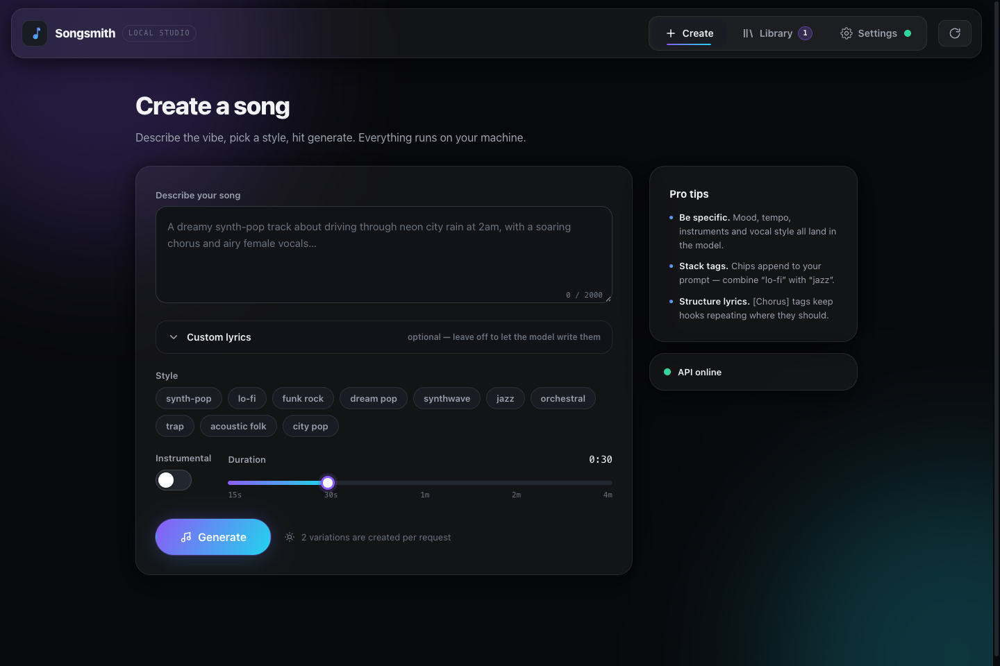
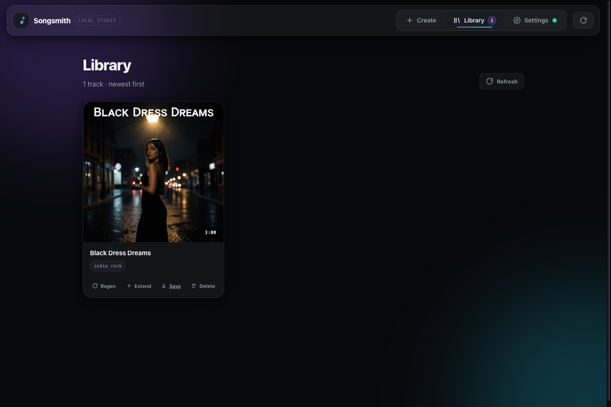
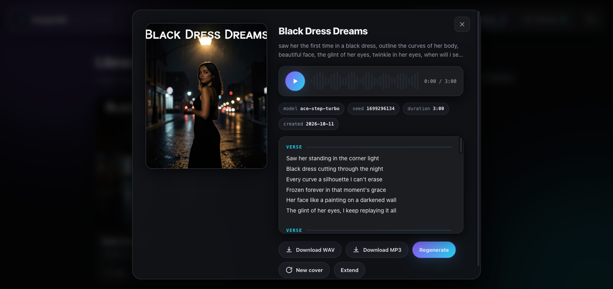
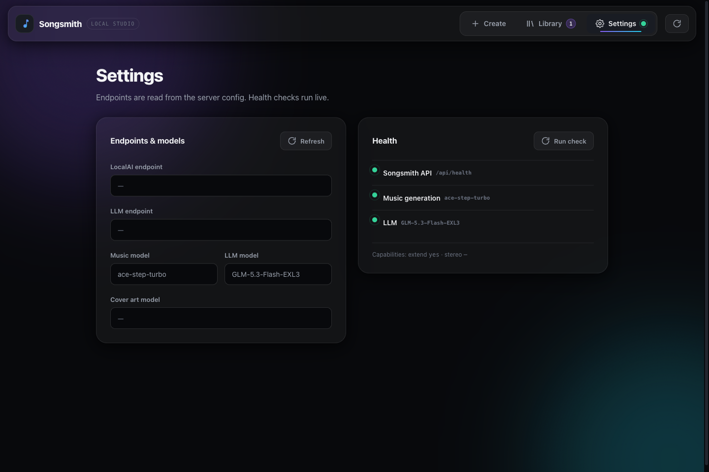

# Songsmith

Songsmith is a local-first, Suno-style AI music generation studio and web UI. It provides an end-to-end pipeline featuring prompt expansion, lyrics and title generation, music synthesis, and album cover art generation backed by an asynchronous job queue with SQLite persistence.

Currently, it is configured to run with a [LocalAI](https://localai.io) backend for music generation (ACE-Step) and cover art (Flux), paired with a separate OpenAI-compatible endpoint for lyric and title generation (e.g., GLM). It can also be configured to run purely against a single LocalAI instance for all tasks.

## Screenshots

### Song Creation


### Library


### Song detail — playback, lyrics, regenerate & new-cover actions


### Settings


## Sample Output

Listen to a full song generated by Songsmith (featured in the Library screenshot):

<audio controls src="docs/samples/black-dress-dreams.mp3"></audio>

- [Download / Play: Black Dress Dreams (MP3)](docs/samples/black-dress-dreams.mp3)

## Run

```
make dev
```

Then open http://127.0.0.1:8788

## Config

Endpoints, models, host/port, and the data directory are configured in `.env`
(see `.env.example`). Generated audio, covers, and the SQLite database live in
`data/`.

## API (JSON)

- `POST /api/songs` — create 2 variations (async job group)
- `GET /api/songs`, `GET /api/songs/{id}`, `DELETE /api/songs/{id}`
- `POST /api/songs/{id}/regenerate` — new variation, new seed
- `POST /api/songs/{id}/extend` — extend (ace-step-turbo only)
- `GET /api/jobs?group=<id>`, `GET /api/jobs/active` — poll job progress
- `GET /api/health`, `GET /api/config`, `POST /api/lyrics`
